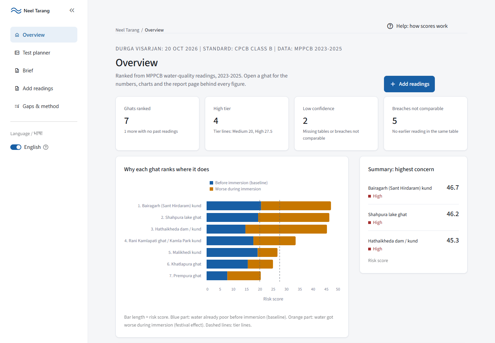
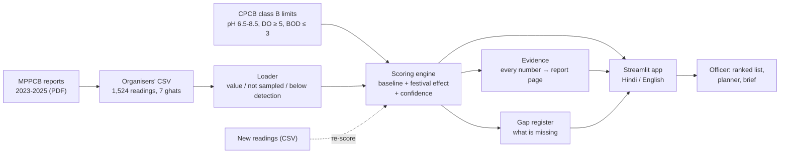
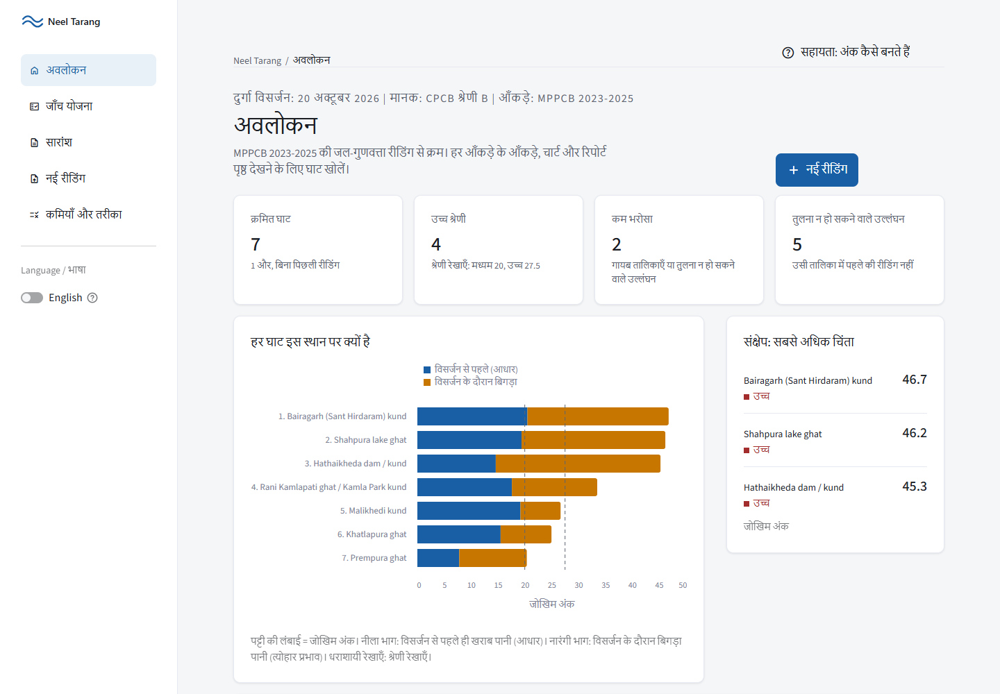
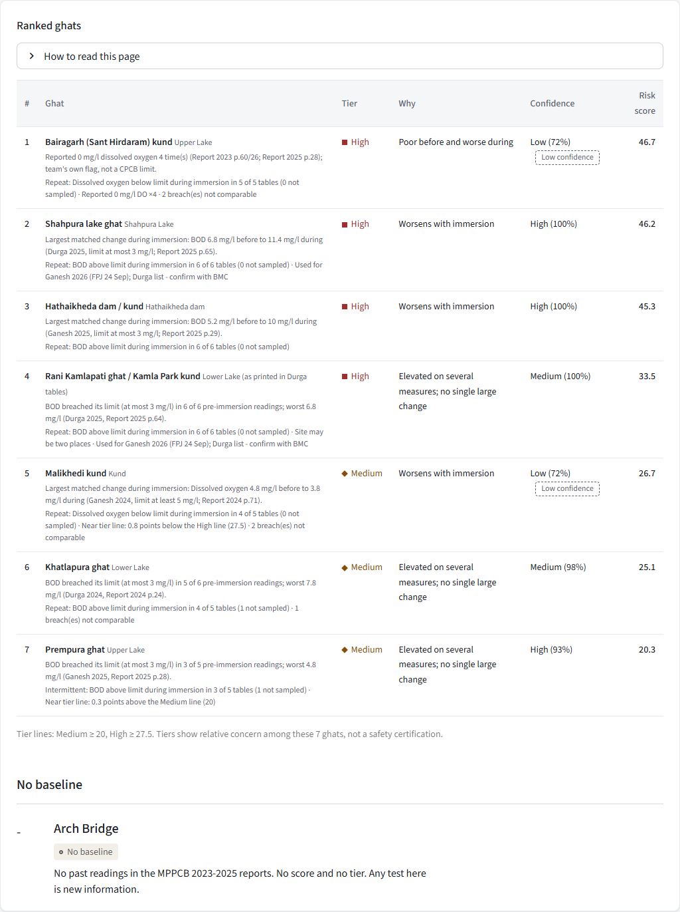
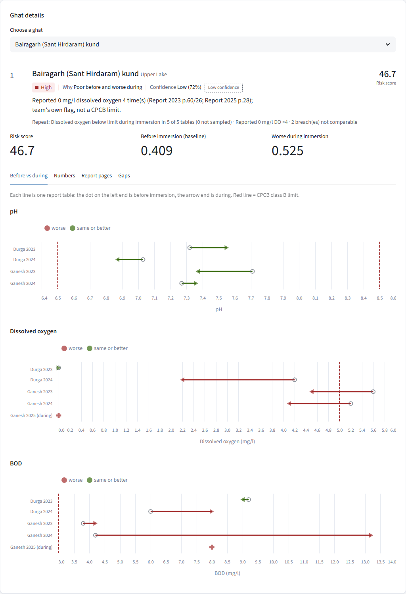
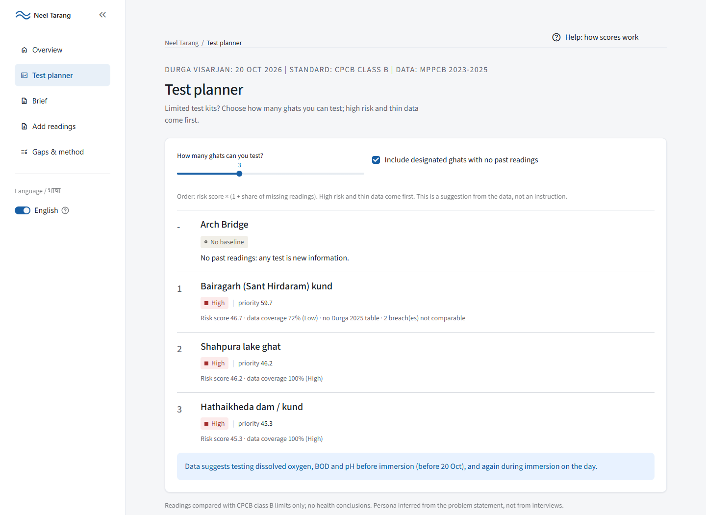
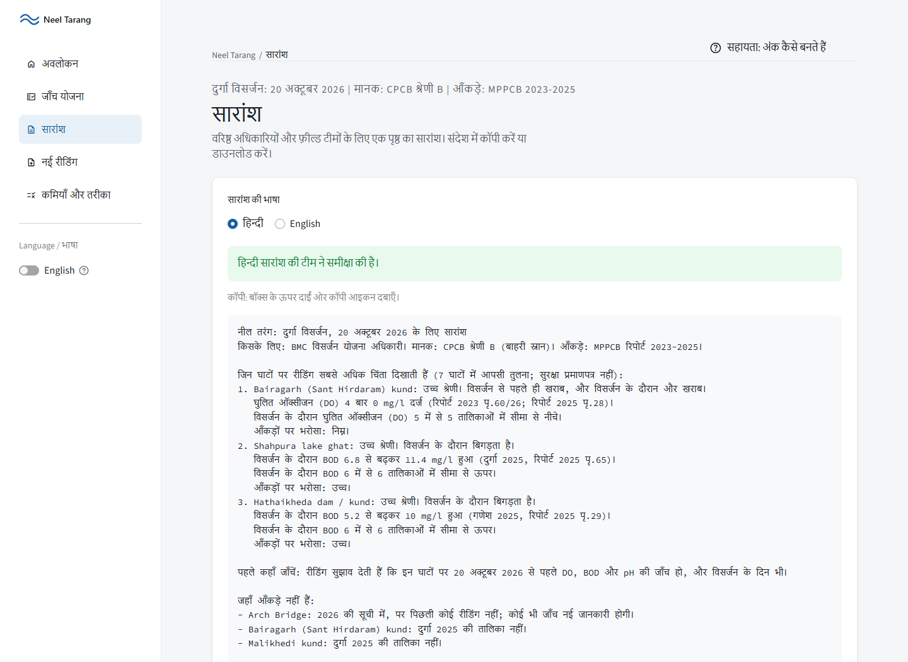
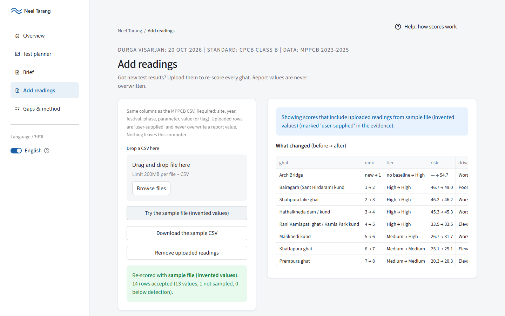

# Neel Tarang (नील तरंग)

**Which Bhopal immersion ghats need attention before Durga visarjan, and why.**

Neel Tarang turns three years of water-test reports into one screen. A Bhopal
Municipal Corporation (BMC) officer can see which ghats are most at risk, why
(was the water already bad, or did immersion make it worse?), how sure we are,
and the exact report page behind every number. It works in Hindi and English,
with no internet and no login.



- **Event:** Claude Impact Lab x Cerebras Cafe Compute, Bhopal, 11 Oct 2026, Track 2 (Visarjan Ghat Watch)
- **Team:** Secretos · **Members:** Ashutosh Mishra
- **The one user:** a BMC officer planning Durga visarjan (20 Oct 2026), deciding
  where to send extra cleaning, aeration and water testing
- **Repository:** https://github.com/ashu-mishra06/Neel-Tarang · **Licence:** MIT

---

## Contents

1. [The problem](#1-the-problem)
2. [Our idea](#2-our-idea)
3. [What the app does](#3-what-the-app-does)
4. [How it works](#4-how-it-works)
5. [How the score is made](#5-how-the-score-is-made-simple-version)
6. [What the data says today](#6-what-the-data-says-today)
7. [App tour (screenshots)](#7-app-tour)
8. [Tech stack](#8-tech-stack)
9. [Folder structure](#9-folder-structure)
10. [Run it yourself](#10-run-it-yourself)
11. [Data sources](#11-data-sources)
12. [Honest limits](#12-honest-limits)

---

## 1. The problem

Every Ganesh and Durga festival, idols are immersed at ghats around Bhopal. The
state pollution board (MPPCB) tests the water **before, during and one week
after** immersion. But:

- The results sit in **90-120 page PDF reports**, one per year.
- Officers planning the next festival mostly decide **from memory**.
- Gaps in the data (tests not done, tables missing) are easy to mistake for
  "no problem".

**Durga visarjan is on 20 Oct 2026.** The officer needs to know quickly where to
send extra cleaning, aeration and water testing, and must be able to defend that
choice.

## 2. Our idea

> **Rank ghats by _why_ they are at risk, not just _how much_.**

Each ghat's risk is split into two parts, because each part needs a different
action:

| Part | What it means | What it suggests |
|---|---|---|
| **Before immersion (baseline)** | The water already breaks the bathing-water limits before any idols arrive | A lake or kund problem: long-term attention |
| **Worse during immersion (festival effect)** | The water gets worse during or after immersion compared with before | Aeration, cleaning and testing on the day |

Every ghat also gets a **confidence** rating. Missing tests lower confidence;
they are **never counted as clean**.

## 3. What the app does

| Section | What you get |
|---|---|
| **Overview** | Four summary numbers, a chart of why each ghat ranks where it does, the top 3, a ranked table, a detail view for any ghat, and the main data gaps |
| **Ghat detail** | Before-vs-during charts against the legal limit, all the numbers, every reading with its **report page image**, and that ghat's gaps |
| **Test planner** | "I can test N ghats before 20 Oct": an ordered list (high risk and thin data first) with reasons |
| **Brief** | A one-page brief in Hindi (reviewed by the team) and English, to copy into a message or download |
| **Add readings** | Upload new test results (same CSV columns); every ghat is re-scored and a "what changed" table appears. Report values are never overwritten |
| **Gaps & method** | Everything the data does not cover, the full method, and downloads of all derived data |

## 4. How it works



- **No AI makes up numbers.** Every number comes from the scoring code in
  `scoring/`. The Hindi and English briefs are filled from the same numbers by
  templates, and a test checks that they match.
- **Everything is traceable.** Each reading links to the public report PDF at
  the exact page, and the app shows the page image.

## 5. How the score is made (simple version)

We use the CPCB "class B" (outdoor bathing) limits for three tests:

| Test | Limit | Bad when |
|---|---|---|
| pH | 6.5 to 8.5 | outside the range |
| Dissolved oxygen (DO) | at least 5 mg/l | lower |
| BOD | at most 3 mg/l | higher |

1. **Baseline (0-1):** how often, and by how much, the *before-immersion*
   readings break the limits.
2. **Festival effect (0-1):** for each report table, how much worse the reading
   got from *before* to *during* (and one week *after*). The worst test decides.
3. **Risk score = 100 x (half baseline + half festival effect).**
4. **Tier:** High (27.5 or more), Medium (20 or more), Low (below 20). A
   reported DO of 0 mg/l always means at least High (our own safety flag, not
   a CPCB rule).
5. **Confidence:** the share of expected readings that actually exist. It drops
   for missing tables, uncertain site names, and breaches that cannot be
   compared.

All weights and cut-offs live in [`rules.yaml`](rules.yaml), and every decision
is explained in [`docs/METHOD.md`](docs/METHOD.md).

## 6. What the data says today

Risk score per ghat (0-100). The full bar is the risk score; the lower,
overlaid bar is the part that comes from **before immersion**. The rest is the
**festival effect**.

```mermaid
xychart-beta
    title "Risk score by ghat (full bar) and its before-immersion part (inner bar)"
    x-axis ["Bairagarh", "Shahpura", "Hathaikheda", "Rani Kamlapati", "Malikhedi", "Khatlapura", "Prempura"]
    y-axis "Risk score" 0 --> 50
    bar [46.7, 46.2, 45.3, 33.5, 26.7, 25.1, 20.3]
    bar [20.5, 19.4, 14.6, 17.6, 19.2, 15.5, 7.8]
```



| Rank | Ghat | Tier | Why | Confidence | Risk |
|---|---|---|---|---|---|
| 1 | Bairagarh (Sant Hirdaram) kund | High | Poor before and worse during | Low (72%) | 46.7 |
| 2 | Shahpura lake ghat | High | Worsens with immersion | High (100%) | 46.2 |
| 3 | Hathaikheda dam / kund | High | Worsens with immersion | High (100%) | 45.3 |
| 4 | Rani Kamlapati ghat / Kamla Park kund | High | Elevated on several measures; no single large change | Medium (100%) | 33.5 |
| 5 | Malikhedi kund | Medium | Worsens with immersion | Low (72%) | 26.7 |
| 6 | Khatlapura ghat | Medium | Elevated on several measures; no single large change | Medium (98%) | 25.1 |
| 7 | Prempura ghat | Medium | Elevated on several measures; no single large change | High (93%) | 20.3 |

**Arch Bridge** is on the 2026 list but has **no past readings**, so it gets no
score; any test there is new information.

Tiers show relative concern among these 7 ghats. They are **not a safety
certification**, and the app draws no health conclusions.

## 7. App tour

| | |
|---|---|
| **Overview (Hindi, the default)**  | **Ranked ghats table**  |
| **Ghat detail: before vs during against the limit**  | **Test planner**  |
| **Brief in Hindi**  | **Add readings: re-score and see what changed** (sample file with invented values)  |

## 8. Tech stack

| Tool | Used for |
|---|---|
| **Python 3.11+** | Everything: engine, app, tests |
| **pandas** | Reading and grouping the readings |
| **PyYAML** | `rules.yaml`: limits, weights, cut-offs, readable by non-coders |
| **Streamlit 1.50** | The web app (sidebar navigation, charts, upload) |
| **Vega-Lite** (via Streamlit) | Bar and before/during charts |
| **PyMuPDF** | Showing the cited report page as an image |
| **Jinja2** | Filling the Hindi and English brief templates |
| **pytest** and **ruff** | 254 tests and linting |
| **Material Symbols** (bundled with Streamlit) | Navigation icons, which work offline |

No database, no login, no API key, no internet needed.

## 9. Folder structure

```text
Neel-Tarang/
├── app.py                  # The Streamlit app: 5 sections, sidebar navigation
├── rules.yaml              # All limits, weights and cut-offs (edit here, not in code)
├── requirements.txt        # Pinned Python packages
├── scoring/                # The engine (no Streamlit in here)
│   ├── loader.py           #   read CSV; value / not sampled / below detection
│   ├── limits.py           #   CPCB class B limits, breach and exceedance
│   ├── engine.py           #   baseline, festival effect, risk, tier, confidence, ranking
│   ├── pairs.py            #   matched before/during pairs, unpaired breaches
│   ├── reasons.py          #   plain-words reasons with report pages
│   ├── evidence.py         #   every reading → report link + page image
│   ├── gaps.py             #   gap register (what the data does not cover)
│   ├── persistence.py      #   "breached in X of Y tables"
│   ├── planner.py          #   test planner order
│   ├── brief.py            #   Hindi / English brief
│   └── rescore.py          #   upload validation and re-scoring
├── ui/                     # Look and feel (components, charts, Hindi strings, logo)
├── briefs/                 # Brief templates (en.j2, hi.j2), glossary, Hindi review status
├── data/                   # Organisers' files (unchanged) + context/, derived/, samples/
├── resources/              # The MPPCB report PDFs
├── docs/                   # METHOD.md (method, gaps, verification), DESIGN.md, screenshots/
└── tests/                  # 254 tests: golden numbers, honesty, evidence, UI, upload
```

## 10. Run it yourself

```bash
git clone https://github.com/ashu-mishra06/Neel-Tarang.git
cd Neel-Tarang
python -m venv .venv && source .venv/bin/activate   # Windows: .venv\Scripts\activate
pip install -r requirements.txt
streamlit run app.py
```

- Run the tests: `pytest` (254 tests). Print the ranking in a terminal:
  `python -m scoring.engine`.
- **Deploy (Streamlit Community Cloud):** New app → this repo, branch `main`,
  file `app.py`, Python 3.12. No secrets are needed.

## 11. Data sources

- **MPPCB Ganesh and Durga visarjan reports 2023, 2024, 2025** (public PDFs,
  in `resources/`; links in [`data/DATA_DICTIONARY.md`](data/DATA_DICTIONARY.md)).
- **Organisers' CSV** `data/bhopal_ghats_2023_2025.csv`: 1,524 readings, 7
  ghats, kept **unchanged**.
- **CPCB water quality criteria** `data/cpcb_water_quality_criteria.csv`.
- **2026 ghat lists** (`data/context/designated_ghats_2026.csv`):
  - Free Press Journal, 22 Sep 2026: [BMC Deploys 174 Divers At Bhopal Ghats For Ganesh Idol Immersion](https://www.freepressjournal.in/bhopal/bmc-deploys-174-divers-at-bhopal-ghats-for-ganesh-idol-immersion) (designated list).
  - Free Press Journal, 24 Sep 2026: [Nearly 30 Ganpati Collection Stalls Set Up...](https://www.freepressjournal.in/bhopal/bhopal-ganesh-visarjan-2026-nearly-30-ganpati-collection-stalls-set-up-180-divers-deployed-khatlapura-ghat-prempura-ghat-ready-ahead-of-anant-chaturdashi) (adds Shahpura and Rani Kamlapati as in use).
- The statewide file `mp_immersion_sites_2023_2025.csv` is **not used**. It was
  planned only as a less-checked context benchmark, which was cut.

## 12. Honest limits

**What works:** scoring, evidence links (all 1,476 printed values were found on
their cited PDF pages), gap register, Hindi/English interface, brief, test
planner, persistence badge, re-scoring with uploaded readings, 254 passing tests.

**What to keep in mind:**
- **Units are assumed.** The reports print none.
- **Only 4 metals were tested**, and none has a bathing-water limit, so metals are
  shown but not scored.
- **Past readings come from lake-side ghats**, while 2026 immersion uses kunds.
- The 2026 lists are for **Ganesh**; the **Durga list may differ** (confirm with BMC).
- **Rani Kamlapati / Kamla Park** may be two different places; it is kept as one and
  marked.
- The **Hindi brief is reviewed** by the team; the Hindi **interface** text is still a
  draft.
- **Not done yet:** a human check of 10 evidence rows (listed in `docs/METHOD.md`),
  and a usability test with a non-technical user.
- The user persona comes from the problem statement, **not from interviews**.

**Not included (cut for time):** share card image (7C), statewide benchmark (7D),
lake cross-check, map view, "ask the data" box, PDF export of the brief.

---

MIT licence. See [`LICENSE`](LICENSE). Offered to the Government of Madhya
Pradesh through MPSeDC.
